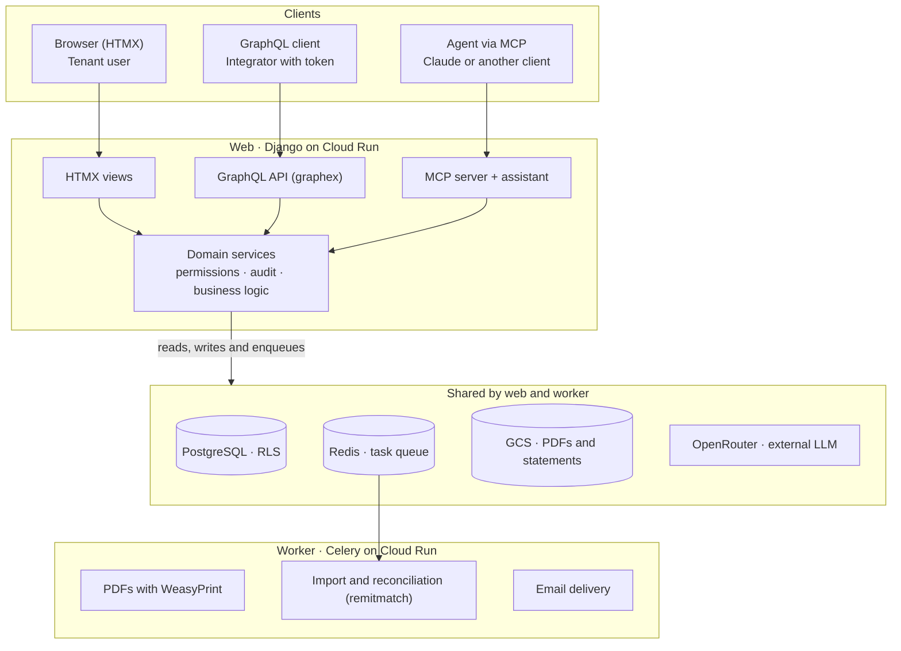

# InvoiceHub

[](https://github.com/eamigo86/invoicehub/actions/workflows/ci.yml)
[](LICENSE)

**Multi-tenant invoicing for small businesses — invoices, bank reconciliation and an AI assistant —
with each company's data isolated by PostgreSQL Row-Level Security.**

## Try it

With Docker and `make`:

```bash
git clone https://github.com/eamigo86/invoicehub.git && cd invoicehub
make demo
```

In about two minutes this starts the stack, seeds a demo company with fictitious US invoices,
imports a bank statement built from them and reconciles it in the Celery worker. It prints the
admin URL and the demo login (local use only). The review queue holds a suggested and an ambiguous
match; the statement itself is in `media/demo/bank_statement.csv`.

## At a glance

| Area | What it does | Status |
| --- | --- | --- |
| Tenant isolation | Every query is scoped twice: by the application and by Row-Level Security. An isolation suite runs as its own CI gate | Done |
| Accounts and roles | Email login with mandatory verification (django-allauth), owner/admin/accountant/viewer roles, hashed and revocable per-tenant API tokens with scopes | Done |
| Billing | Invoices and credit notes with gap-free numbering, PDFs, email delivery, configurable sales tax rates | Done |
| Reconciliation | CSV bank statements matched to invoices with [remitmatch](docs/rfc/0001-remitmatch.md), with a review queue for ambiguous matches | Done |
| Integrations | GraphQL API for integrators (django-graphex) and an MCP server for agents | Planned |
| AI assistant | Drafts invoices and reminders, answers questions about the business, explains ambiguous matches; evals in CI | Planned |

## Architecture

A Django monolith with three entry points (HTMX UI, GraphQL API, MCP server) that share one
services layer, plus a Celery worker for everything slow. The web app and the worker use
PostgreSQL (with Row-Level Security) and Redis as the task queue.



## Quick start

Only Docker is needed.

```bash
git clone https://github.com/eamigo86/invoicehub.git && cd invoicehub
docker compose up -d --build --wait
docker compose exec web python manage.py createsuperuser
```

Then sign in at http://localhost:8010/accounts/login/. Email verification is mandatory; the
verification email lands in Mailpit at http://localhost:8025.

## Details

### Signing in and choosing a company

The admin login goes through the same sign-in page. A user with a single company gets it selected
on login; otherwise `/tenants/` lists the user's companies, switches between them and creates a new
one. Tenant models stay hidden in the admin until a company is active.

### Ports

They listen on 127.0.0.1 only, so the demo login and the databases stay on this machine. Override
the ports with environment variables or a `.env` file.

| Service | URL / port | Variable |
| --- | --- | --- |
| Web (admin at `/admin/`) | http://localhost:8010 | `WEB_PORT` |
| PostgreSQL | localhost:5442 | `POSTGRES_PORT` |
| Redis | localhost:6390 | `REDIS_PORT` |
| Mailpit UI | http://localhost:8025 | `MAILPIT_UI_PORT` |
| Mailpit SMTP | localhost:1025 | `MAILPIT_SMTP_PORT` |

### Database roles

Containers connect to PostgreSQL as the unprivileged `invoicehub_app` role; only the migrate step
uses `invoicehub_migrator`, which owns the tables. Host-side commands (pytest, migrate, runserver)
connect as the migrator; `FORCE ROW LEVEL SECURITY` keeps the tenant policies applying to it as well.

### Checks and tests on the host

Requires [uv](https://docs.astral.sh/uv/) and Python 3.13, with the Compose stack running, and Pango for the invoice PDFs (WeasyPrint): `brew install pango` on macOS, or `libpango-1.0-0 libpangoft2-1.0-0 libharfbuzz-subset0` on Debian and Ubuntu.

```bash
cp .env.example .env             # connects as invoicehub_migrator on localhost:5442
uv sync
uv run ruff check . && uv run ruff format --check .
uv run mypy .
uv run python manage.py makemigrations --check
uv run pytest --cov              # needs the Compose postgres and redis running
uv run pytest -m isolation       # tenant isolation suite only (also part of the full run)
uv run pre-commit install        # optional: run the checks on every commit
```

## Design documents

The design lives in RFCs under [`docs/rfc/`](docs/rfc/). They are drafts and may change.

| RFC | Area | Main decision |
| --- | --- | --- |
| [0000](docs/rfc/0000-overview.md) | Overview | Scope, architecture, cross-cutting decisions and plan |
| [0001](docs/rfc/0001-remitmatch.md) | remitmatch library | Rust + PyO3, split and grouped payments in v1 |
| [0002](docs/rfc/0002-tenancy.md) | Multi-tenancy and authentication | `tenant_id` column + Row-Level Security |
| [0003](docs/rfc/0003-billing.md) | Billing domain | Gap-free numbering per series; issued invoice is immutable |
| [0004](docs/rfc/0004-api-ui.md) | API and UI | GraphQL with django-graphex; HTMX for the UI |
| [0005](docs/rfc/0005-reconciliation.md) | Bank reconciliation | Asynchronous import + review queue |
| [0006](docs/rfc/0006-ai.md) | Applied AI | OpenRouter, tools with user permissions, evals in CI |
| [0007](docs/rfc/0007-infra.md) | Infrastructure | Cloud Run + Cloud SQL; OpenTelemetry and Sentry |

## License

[MIT](LICENSE)
