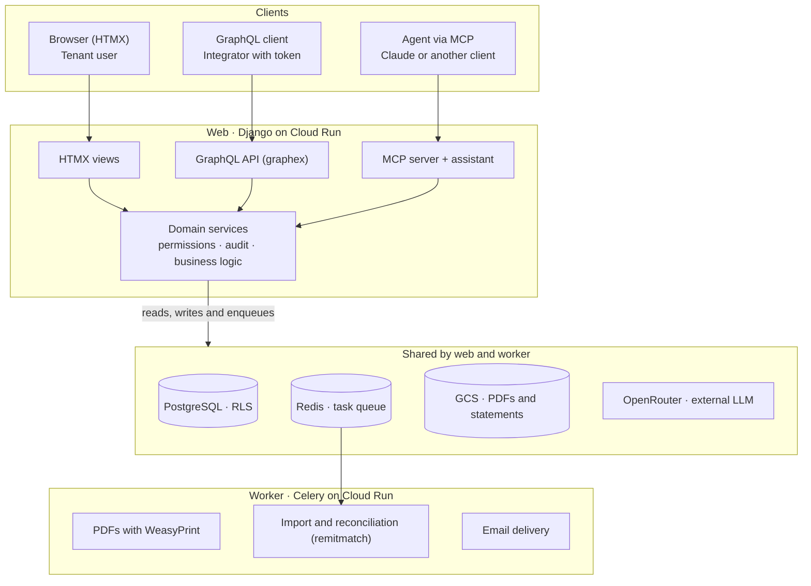

# InvoiceHub

InvoiceHub is a multi-tenant invoicing SaaS for SMBs and freelancers. It issues invoices and PDFs,
reconciles bank payments against invoices with [remitmatch](docs/rfc/0001-remitmatch.md), and
includes an AI assistant exposed through an MCP server. Tenant isolation is enforced twice: by the
application and by PostgreSQL Row-Level Security.

## Architecture

A Django monolith with three entry points (HTMX UI, GraphQL API, MCP server) that share one
services layer, plus a Celery worker for everything slow. The web app and the worker use
PostgreSQL (with Row-Level Security) and Redis as the task queue.



Design documents live in [`docs/rfc/`](docs/rfc/). They are drafts and may change.

## Run locally

Requirements: Docker, [uv](https://docs.astral.sh/uv/) and Python 3.13.

```bash
docker compose up -d --build     # web, worker, postgres, redis, mailpit
docker compose exec web python manage.py createsuperuser
```

Default host ports (override with environment variables or a `.env` file):

| Service | URL / port | Variable |
| --- | --- | --- |
| Web (admin at `/admin/`) | http://localhost:8010 | `WEB_PORT` |
| PostgreSQL | localhost:5442 | `POSTGRES_PORT` |
| Redis | localhost:6390 | `REDIS_PORT` |
| Mailpit UI | http://localhost:8025 | `MAILPIT_UI_PORT` |
| Mailpit SMTP | localhost:1025 | `MAILPIT_SMTP_PORT` |

Containers connect to PostgreSQL as the unprivileged `invoicehub_app` role; only the migrate step
uses `invoicehub_migrator`.

### Signing in and choosing a company

Sign in at http://localhost:8010/accounts/login/; the admin login goes through the same page. Email
verification is mandatory, and in development the verification emails land in Mailpit
(http://localhost:8025). A user with a single company gets it selected on login; otherwise
`/tenants/` lists the user's companies, switches between them and creates a new one. Tenant models
stay hidden in the admin until a company is active.

### Checks and tests on the host

```bash
cp .env.example .env             # connects as invoicehub_migrator on localhost:5442
uv sync
uv run ruff check . && uv run ruff format --check .
uv run mypy .
uv run python manage.py makemigrations --check
uv run pytest --cov              # needs the Compose postgres and redis running
uv run pytest -m isolation       # tenant isolation suite only (also part of the full run)
uv run pre-commit install        # optional: run the checks on every commit
```

Host-side commands (pytest, migrate, runserver) connect as the migrator, which owns the tables;
`FORCE ROW LEVEL SECURITY` keeps the tenant policies applying to it as well.

## Status

Early development. In place: the project scaffold, Docker stack, database roles, tooling and CI;
the tenancy foundation (request-scoped tenant context, Row-Level Security, the parametrized
isolation suite); and authentication and roles (django-allauth email login with mandatory
verification, memberships with owner, admin, accountant and viewer roles, company selection, and
hashed, revocable per-tenant API tokens with scopes). Next: billing (RFC 0003).

## License

[MIT](LICENSE)
