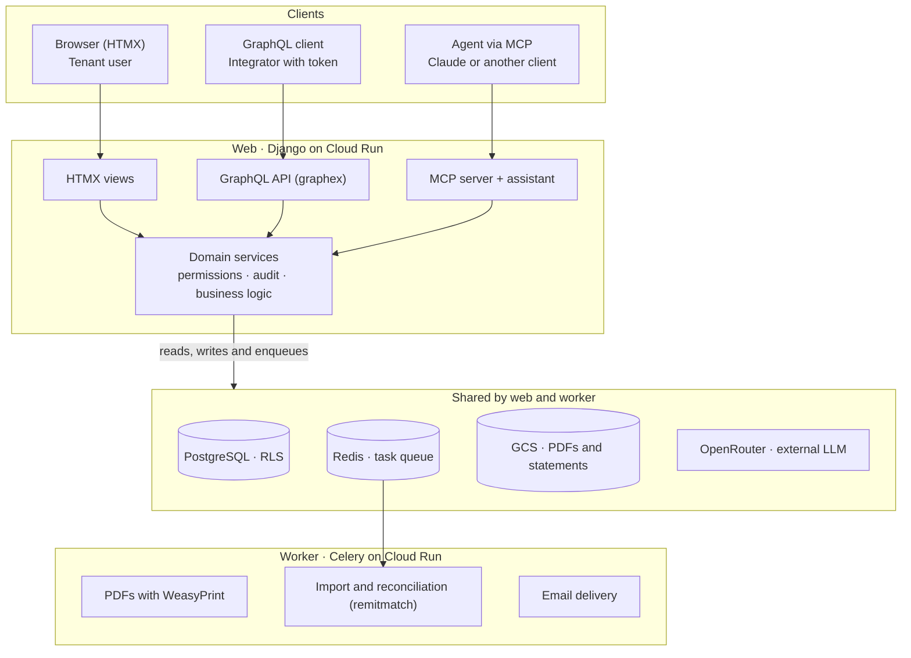

# InvoiceHub — Overview and RFCs

**Status:** draft · **Type:** project overview + RFCs by area · **Date:** 2026-11-22

## Problem, users and success metrics

InvoiceHub is a multi-tenant invoicing SaaS for SMBs and freelancers that issues invoices, reconciles payments against the bank, and uses AI for repetitive work. It is a public reference project: it has to actually work and demonstrate senior-level judgment.

**Problem.** SMBs invoice with spreadsheets or expensive tools, and then match bank payments to invoices by hand. It is slow, error-prone and does not scale.

**Users**

- **Tenant administrator:** configures the company, invoice series, taxes and users.
- **Accountant / biller:** creates and sends invoices, reviews the reconciliation.
- **Integrator:** uses the GraphQL API or the MCP server from another system or agent.

**Who reviews the project:** an engineer who goes through the repo, the live demo and the RFCs in 15–30 minutes.

| Metric | Target |
| --- | --- |
| Live demo with sample data | Accessible without sign-up, with a demo tenant of fictitious US data (Faker) that resets every night |
| From zero to invoice sent | < 2 minutes for a new user |
| Automatic reconciliation | ≥ 85 % of payments matched without intervention on the demo dataset |
| Repo quality | Green CI, coverage ≥ 85 %, README with architecture and benchmarks |
| Isolation between tenants | 0 leaks in the isolation test suite (mandatory in CI) |

## v1 scope

v1 covers the full lifecycle of an invoice, from creation to reconciled payment; everything else is out of scope so it fits in the 12-week plan.

**In v1**

- Company (tenant) registration, user invitations and roles
- Customers, products/services and configurable tax rates
- Invoices and credit notes with gap-free numbering per series
- Invoice PDF and delivery by email
- Bank statement import in CSV and reconciliation with remitmatch
- AI assistant: invoice drafts from text or email, questions about the business, explanation of ambiguous reconciliations, collections (dunning) reminder drafts and tax rate or product suggestions (RFC 0006)
- GraphQL API (django-graphex) and MCP server
- Public demo deployed on GCP

**Out of v1**

- Legal e-invoicing for a specific country (Verifactu, CFDI, Peppol)
- Sales tax compliance: per-state rules, nexus, exemption certificates and automatic rate lookup (the tenant configures its own rates)
- Online payments (Stripe) and recurring subscriptions
- Full accounting (general ledger, balance sheets)
- Real-time bank connection (Plaid, open banking)
- Native mobile app (a dj-hyperview client is optional)

## Architecture

A well-divided Django monolith: three entry points (UI, GraphQL, MCP) that share a single services layer, and a Celery worker for everything slow.



The web app enqueues to Redis and the worker consumes from there; both read and write to PostgreSQL and GCS, and the assistant calls OpenRouter.

## Stack and cross-cutting decisions

Django as the core because it is where the most experience is and what best solves a business domain with admin, ORM and migrations; the rest is chosen for being the industry standard.

| Layer | Choice | RFC |
| --- | --- | --- |
| Language and framework | Python 3.13, Django 6.1.x | — |
| Database | PostgreSQL 17 with Row-Level Security | 0002 |
| Background tasks | Celery + Redis | 0003, 0005 |
| API | GraphQL with django-graphex | 0004 |
| UI | Django templates + HTMX + Tailwind (standalone CLI, no Node) | 0004 |
| Admin | Django admin with django-unfold | 0004 |
| PDFs | WeasyPrint | 0003 |
| Files | django-storages on GCS (local in development) | 0003, 0007 |
| Reconciliation | remitmatch (Rust + PyO3, RFC 0001) | 0005 |
| LLM | OpenRouter behind a custom adapter | 0006 |
| Deployment | Docker, Cloud Run, Cloud SQL, Memorystore | 0007 |
| Observability | OpenTelemetry, Sentry, structured logs | 0007 |
| Quality | pytest, ruff, mypy, pre-commit, GitHub Actions | 0007 |
| Demo and seed data | Faker (`en_US`, fixed seed) | 0007 |

**Cross-cutting decisions**

- **Money:** integers in cents (`BigIntegerField`) + currency code; never `float`.
- **Market:** North America first. USD by default, the EIN as the business tax ID, sales tax as configurable tax rates, and credit notes for corrections. InvoiceHub calculates the rates the tenant configures; it does not promise tax compliance.
- **Dates:** always timezone-aware; the tenant's timezone is used only for display.
- **Idempotency:** every Celery task and every mutation with external effects (email, import) carries an idempotency key.
- **Audit:** actions on invoices are recorded (who, what, when), including those by the AI.
- **Testing:** strict TDD for all code: a failing test first (RED), the minimum code to make it pass (GREEN), then refactor. Config-only files (Dockerfile, Compose, CI) are verified by running them.
- **Documentation:** every public module, class, function and method has a complete Google-style docstring; types live only in the signature; docstrings are plain text, with no backticks.
- **Language:** code, commits, RFCs and UI in English.

## RFC index

Each area with its own decisions has its own RFC; 0001 is the reconciliation library, which lives in its own repo.

| RFC | Area | Main decision |
| --- | --- | --- |
| [0001](0001-remitmatch.md) | remitmatch library | Rust + PyO3, split and grouped payments in v1 |
| [0002](0002-tenancy.md) | Multi-tenancy and authentication | `tenant_id` column + Row-Level Security |
| [0003](0003-billing.md) | Billing domain | Gap-free numbering per series; issued invoice is immutable |
| [0004](0004-api-ui.md) | API and UI | GraphQL with django-graphex; HTMX for the UI |
| [0005](0005-reconciliation.md) | Bank reconciliation | Asynchronous import + review queue |
| [0006](0006-ai.md) | Applied AI | OpenRouter, tools with user permissions, evals in CI |
| [0007](0007-infra.md) | Infrastructure | Cloud Run + Cloud SQL; OpenTelemetry and Sentry |

## Weekly plan

The public demo is in week 10 and the last two weeks are left for articles and polish.

```mermaid
gantt
    title Public demo in week 10
    dateFormat  X
    axisFormat  S%s
    section Blocks
    Foundation: CI, tenancy and auth :0, 2
    Billing and PDFs                :2, 5
    remitmatch (RFC 0001)           :2, 6
    Reconciliation in the app       :5, 7
    AI: assistant, MCP, evals       :7, 9
    Deployment and observability    :8, 10
    Articles and polish             :10, 12
    section Milestones
    remitmatch 0.1.0 on PyPI        :milestone, 5, 0
    Public demo on GCP              :milestone, 10, 0
```

Blocks overlap on purpose: remitmatch advances in parallel with billing, and the AI starts once there are invoices and reconciliation to query.

## Project risks

The biggest risk is scope: it is a 12-week plan, so each RFC marks what can be cut.

| Risk | Impact | Mitigation |
| --- | --- | --- |
| Scope too large | Incomplete demo at the week 10 milestone | Cuts already defined: dj-hyperview, MCP server and Terraform are optional |
| Data leak between tenants | Serious and visible failure in a code review | RLS in Postgres + mandatory isolation suite in CI (RFC 0002) |
| LLM cost on the public demo | Unexpected OpenRouter bill | Per-tenant limit, cheap models by default and monthly spending cap (RFC 0006) |
| Abuse of the public demo | Email spam, load | Real email delivery disabled in the demo tenant; rate limiting |
| remitmatch delay | Reconciliation does not make it to the demo | Stable interface from week 3; Python implementation as fallback |
